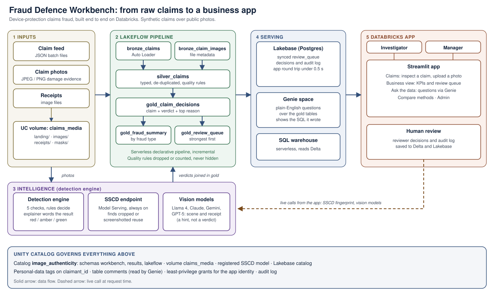
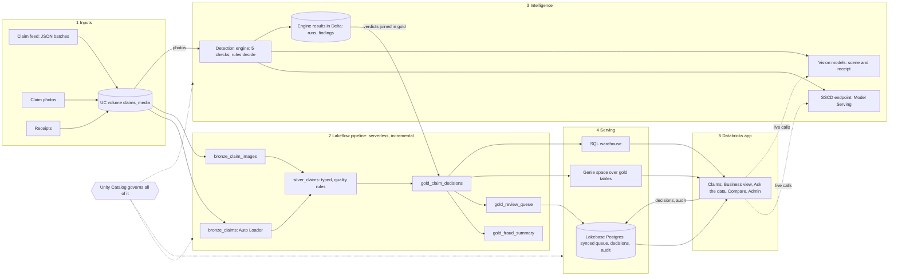

# Architecture

The same picture as text, so it can be read without rendering the image:

## Components and where they live

| Component | What it does | In this repo |
|---|---|---|
| UC volume `claims_media` | Landing zone for the claim feed, photos, receipts and masks | `pipeline/claims_pipeline.sql` (reads it) |
| Lakeflow pipeline | Auto Loader ingest, quality rules, gold tables for the business | `pipeline/claims_pipeline.sql`, `evidence/01_*`, `evidence/02_*` |
| Detection engine | Five checks and a rules engine that decides, with a written reason | `image_authenticity/workbench/` |
| SSCD endpoint | Learned copy detection, always on, called live for new photos | `build/register_sscd.py`, `app/` (client in `models.py`) |
| Vision models | Scene reading and receipt OCR through Foundation Model endpoints | `image_authenticity/workbench/models.py` |
| Lakebase | Review queue synced from gold; decisions and audit log written in well under a second | `lakebase/`, `app/lakebase.py`, `evidence/04_*` |
| Genie space | Plain-English questions over the gold tables | `genie/`, `app/genie_client.py`, `evidence/03_*` |
| Databricks app | What investigators and managers use | `app/` |
| Unity Catalog | Catalog, schemas, volume, model, tags, comments, least-privilege grants | `uc/governance.sql`, `evidence/06_*` |

Order note: "3 Intelligence" sits below the pipeline in the picture because it both reads the photos from the volume and feeds its verdicts back into the gold tables.
